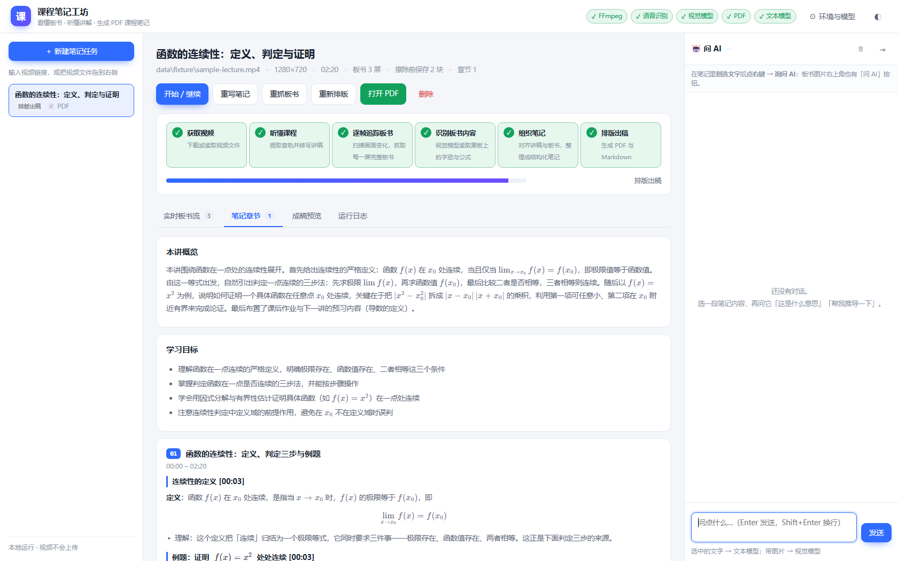
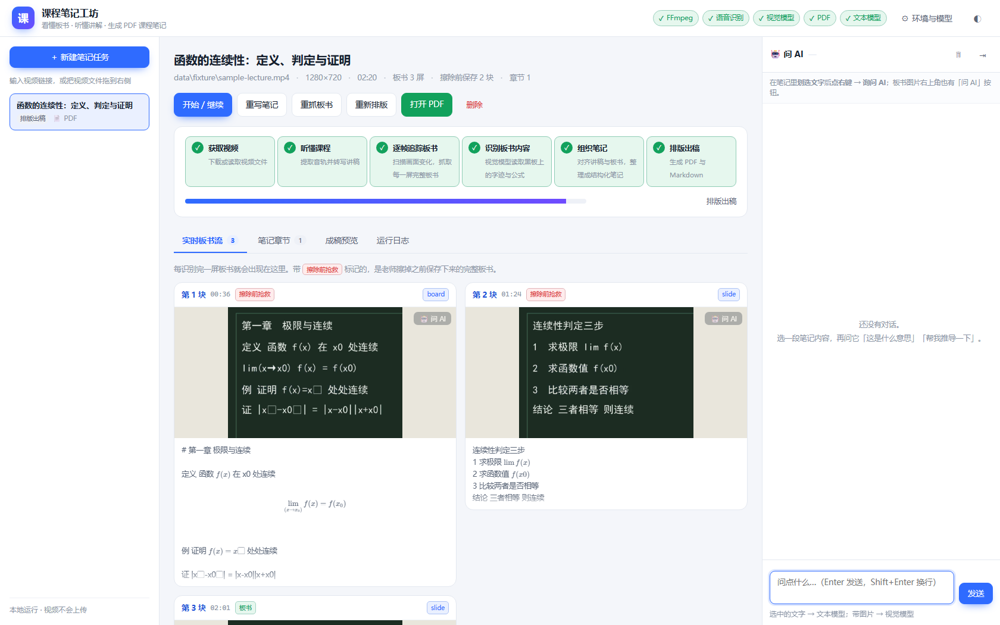
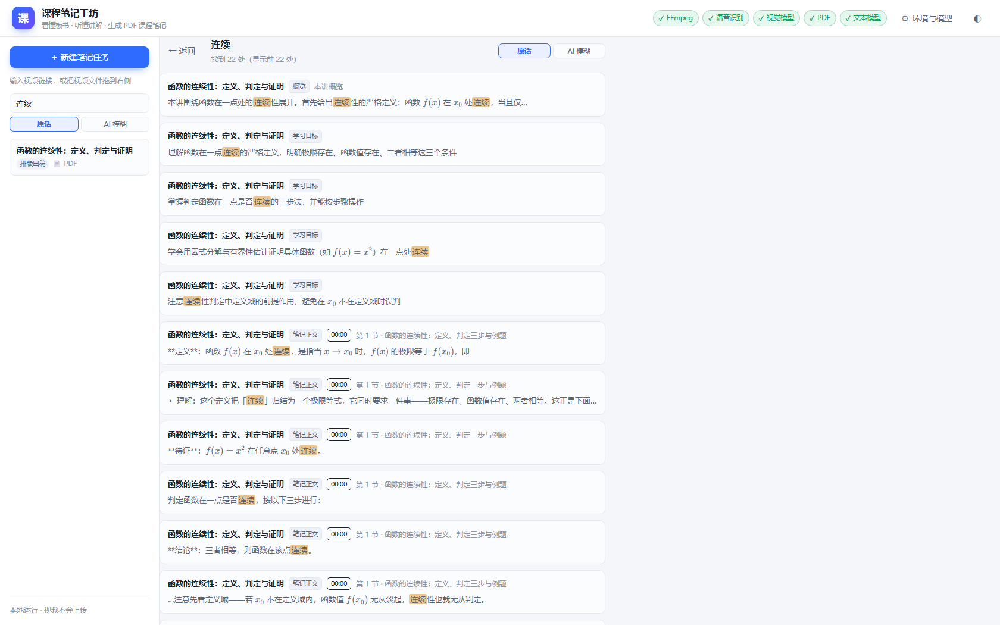
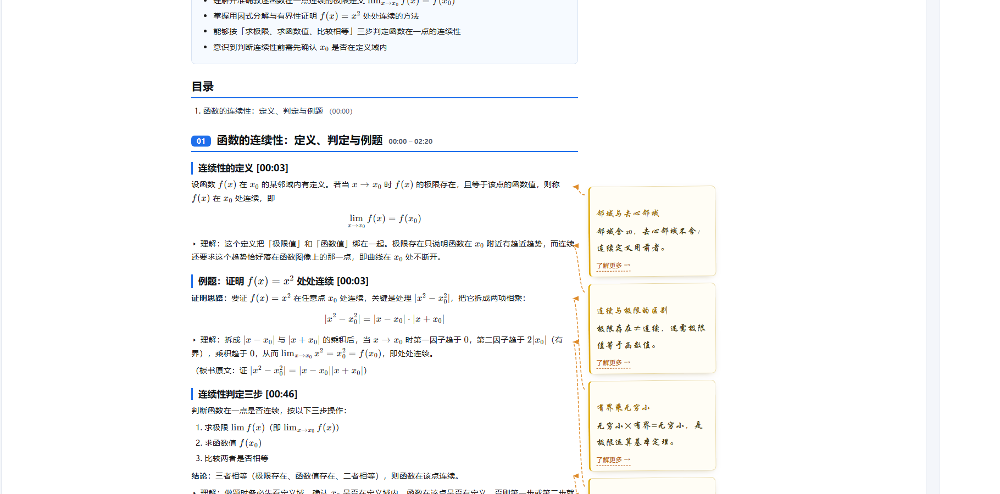
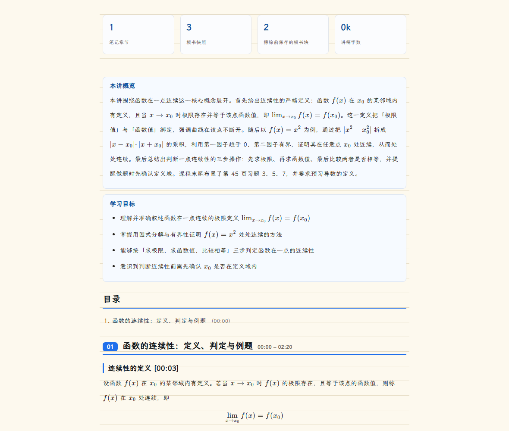
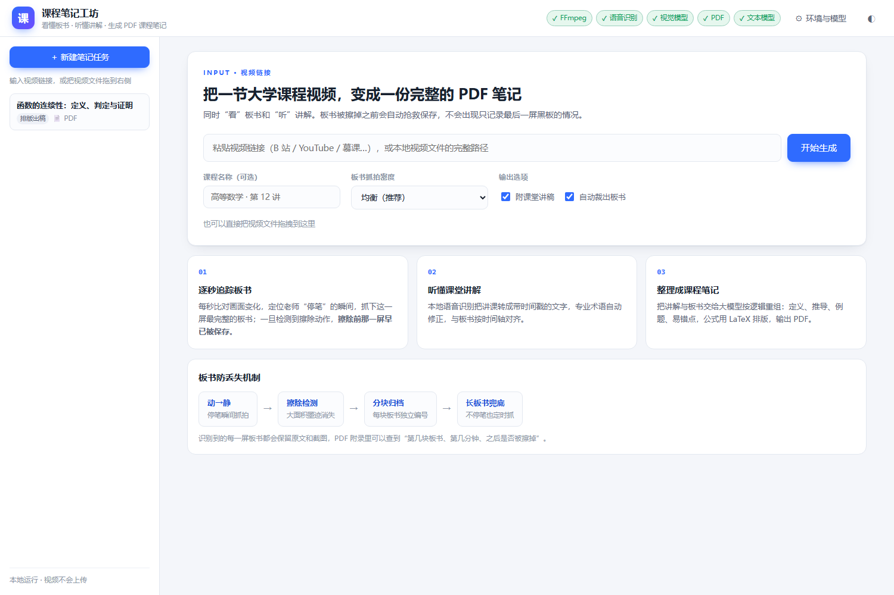

# 课程笔记工坊 · CourseNoteStudio

把一节大学课程视频（链接或本地文件）变成一份**完整、结构化、可打印的 PDF 课程笔记**。

> Turn a university lecture video into complete, structured, printable PDF course notes.
> It watches the blackboard frame-by-frame (saving it **before the teacher erases it**),
> transcribes the audio locally, then has an LLM organise everything into notes — with a
> built-in AI panel for asking questions about the notes. Windows · Node.js · local models.

[](LICENSE)



它会同时做两件事：

- **看**——逐秒扫描画面，追踪黑板/白板/PPT 上的板书，**在板书被擦掉之前把它保存下来**；
- **听**——把讲课语音转写成带时间戳的文字，和板书按时间轴对齐。

最后交给大模型按逻辑整理：概念定义、推导过程、例题步骤、易错点、公式汇总、术语表、复习自测，排版成 PDF。

| 实时板书流 | 全局搜索 |
| --- | --- |
|  |  |

**AI 补充**：点一下「✨ AI 补充」，课程里没讲到、但理解本节很关键的知识点会以**手写体批注**的形式出现在成稿右侧空白处，并用虚线箭头指向对应段落；点批注里的「了解更多」可以看详细解释。



**字体与纸张**：笔记正文可换成霞鹜文楷（开源硬笔手写体），纸张可选纯白 / 米黄 / 米黄横线笔记本纸 —— 成稿预览与 PDF 完全一致。





**为什么要专门做「板书擦除」这件事？** 绝大多数同类工具只截取视频结尾的黑板，结果笔记里只剩最后一屏。
本项目全程跟踪每一块板书的内容量，**擦黑板的那一刻把「刚刚写得最全的那一屏」存下来**——
所以每块板书既完整、又只有一张图，不会出现「刚起笔只写了两个字」的废截图。

---

## 一、快速开始

1. **双击 `安装组件.bat`**（只需第一次运行）
   下载 FFmpeg、yt-dlp、llama.cpp、sherpa-onnx 与视觉/语音模型，合计约 3.5 GB，支持断点续传。
2. **双击 `启动.bat`**
   浏览器会自动打开 <http://127.0.0.1:7788>。
   **关掉所有页面后程序会自动退出**，那个黑窗口也会一起关闭——不用手动清理。
   （想让它一直挂着，比如给局域网里别人用：`node app/main.mjs serve --keep-open`）

3. 在首页粘贴视频链接（B 站 / YouTube / 慕课等），或**直接把本地视频文件拖进页面**，点「开始生成」。

   > 重复双击 `启动.bat` 也不会报错：如果 7788 上已经有**本程序**在跑，它会自动把旧实例换成新版本；
   > 如果端口被**别的程序**占用，会自动往后找（7789、7790…）并在窗口里显示实际地址。

4. 右侧「环境与模型」面板可以看到每个组件的状态与安装进度；文本模型默认复用本机 DSH 已保存的 DeepSeek Key，也可以自己填任意 OpenAI 兼容接口。

5. 出稿后到「成稿预览」：**PDF 不会自动生成**，需要时点 **「📄 导出 PDF」**（几秒钟，不调用模型）。

   - 预览右上角有一个 **⛶** 按钮，可以**全屏**看整份成稿：全屏下成稿会呈现成**一张 A4 纸**（灰底 + 纸面阴影），顶部有 **－ 100% ＋** 缩放（「100%」按钮即适应宽度），按 Esc 或 ✕ 退出；
   - 全屏时最右边有一条窄边，点它可以**滑出 AI 问答面板**，一边看稿一边问；退出全屏后 AI 面板自动回到原位；
   - 想让每次生成都自动出 PDF，把「环境与模型 → 抓拍与输出 → 自动导出 PDF」勾上即可。

6. 右栏 **「🤖 问 AI」** 一直开着（可点右上角 ⇥ 收起，收成一条窄边再点开）：
   - 在笔记里**划选文字后点右键 → 「询问 AI」**，选中的内容就直接进输入框，不用先复制粘贴（右键菜单里还有「直接解释这段」和「复制」）；
   - 板书图片右上角有 **「🤖 问 AI」** 按钮，点一下把这张板书发给 AI；图片放大后右下角也有；
   - 同时带文字和图片时，自动交给视觉模型；
   - 回答按任务保存，刷新页面不丢。
7. **三栏宽度都能拖**：最左任务栏、中间笔记、右侧 AI 面板之间的竖线可以用鼠标拖动（双击复位），宽度会记住。

8. **全局搜索**：左侧任务栏上方有搜索框（就是上图那张），一次搜遍**所有任务**的笔记正文、板书识别结果和课堂讲稿原话。

   - **原话模式**：按字面查找。输入老师说的原话、某个术语或公式，直接命中并**高亮**。多个词用空格分开表示「都要包含」，例如 `单极点 留数`。
   - **AI 模糊模式**：不记得原话也能找。例如输入「上课举的那个用单位圆算积分的例题是怎么做的」，它会先本地粗排候选，再让文本模型判断哪些片段真正相关，**顺便直接回答你的问题**，并逐条说明「为什么相关」。
   - 点任意一条结果会跳到对应任务、滚动到对应章节并闪烁提示；板书结果跳到板书流。搜索结果页地址形如 `?q=关键词&mode=ai`，可以直接收藏。

9. **AI 补充（旁批）**：到「成稿预览」标签页，点下方的 **「✨ AI 补充」**，AI 会通读全部章节，找出**课程里没讲、但不懂就会卡住**的知识点（前置概念、易错点、直观图像、与其它章节的联系），然后：

   - 在成稿**右侧空白处**生成**手写体批注**，每条都用**虚线箭头**指向对应的段落；
   - 批注尽量简洁（一句到两句话），不打断正文阅读；
   - 每条批注下都有「了解更多 →」：点它会切到标签栏下方新增的 **「📖 补充讲解」**页，里面有 150–300 字的详细解释（含公式推导与极简例子）；**在全屏预览里点击则会就地滑出一个讲解面板**（带「看全部」按钮），不用退出全屏。
   - 批注用**虚线箭头指向具体那一句话**，句子下面还有虚线标记，一眼看出这条补充挂在哪儿；全屏也一样。
   - 觉得不合适可以「重新生成」，也可以取消勾选「显示批注」只看正文。

   > 补充内容会写入该任务的 `work/supplements.json`，只影响界面预览，**不会改动 PDF 成稿**。

10. **AI 审校（红色感叹号）**：出稿前模型会再逐节复核一遍公式与结论，只挑**实质性错误**（公式写错、结论错、条件缺失导致结论不成立、概念混淆）。

    - 出问题那句话后面会出现一个**红底白叹号**，鼠标悬停能看到一句话说明；成稿末尾还有「附录 · AI 审校发现的问题」，列出原文、所在章节和完整分析；
    - **红标是烧进成稿的**：即使你把「显示批注」关掉、或者导出 PDF，红标依然在；
    - 开着批注时，右侧空白处还会多出一条**红色批注**，把问题讲清楚（琥珀色的是 AI 补充，红色的是审校问题）；
    - 想重跑：到「成稿预览」点 **「🔍 AI 审校」**，一两分钟出结果并自动重新排版；
    - 误报比漏报更伤信任，所以标准收得很紧：只要模型自己判断「不影响结论/不影响计算」，就不报。

11. **老师中途更正板书**：老师上课写错了、过一会儿擦掉重写或口头更正，是很常见的情况。程序做了三层处理：

    - 板书按「一代一代」全部保留（错误那一版也在材料里，这是为了不丢内容）；
    - 讲稿里出现「我写错了 / 更正一下 / 应该是 / 擦掉重写 / 漏写了」这类话时会被识别出来，并在整理笔记时**整份提示词里下发**（不只是更正所在那一段 —— 老师可能讲了 10 分钟才发现写错，写前面那段时必须知道后面被更正了）；
    - 笔记里**只保留更正后的最终版本**，并在更正处写一行 `> ⚠️ 此处老师曾更正：原写法…已作废`；成稿末尾另有「附录 · 老师更正过的地方」便于核对。

12. **外观设置**（任务页里「运行日志」右边的 **🎨 外观设置** 标签页）：

   | 分组 | 可调项 |
   | --- | --- |
   | 纸张 | 纯白 A4 / 米黄色 A4 / 米黄色横线笔记本纸 |
   | 正文文字 | 字体（系统默认 / **霞鹜文楷** / 楷体 / 宋体）、字号、颜色（可「跟随纸张」） |
   | AI 讲解（旁注） | **单独一套**字体、字号、颜色 |

   - 正文和 AI 讲解写在**同一张纸**上：纸张留白处就是批注的位置，纸张样式两边一起换；批注只用一个显眼颜色的竖条 + 彩色文字区分，不另起一块便签。
   - 控件改动**立刻反映到「成稿预览」**（服务端 `/api/look.css` 提供同一份外观 CSS，注入 iframe 即时生效），并**自动存为默认** —— 之后点任何「重新排版」都用这一套，随时还能再调。
   - 横线纸是**真正的格子**：格子高度由字号算出来（行高 ≈ 字号 × 1.7），所有纵向间距都取格子整数倍，所以每一行文字都落在横线上、横线严格等间距；**改字号时格子跟着变**，对齐不会散。底纹一律半透明，横线从盒子下面透出来。
   - 「📄 导出 PDF」才生成 PDF，默认不生成、不占空间。
   - 字体文件随「安装组件」下载（霞鹜文楷，开源 SIL 协议），没装时会优雅退回系统楷体。

> 生成一份 90 分钟的课大约需要：板书识别 20–40 分钟 + 语音识别 3–5 分钟 + 整理成文 2–4 分钟。
> 想要更快可以先选「板书抓拍：精简」。

---

## 二、板书为什么不会丢

这是本项目最核心的设计。很多工具只截取视频结尾的黑板，结果笔记里只剩最后一屏——本项目从五个层面避免这件事：

| 机制 | 说明 |
| --- | --- |
| **内容增量抓拍** | 每秒比对画面与「上一次抓拍」的差异，只要板书又写出了足够多的新内容就准备记录，不依赖画面「完全静止」——因此在学生走动、镜头跟拍的教室里同样有效 |
| **等老师停笔** | 准备记录后不立刻按快门：板书内容连续几秒不再增加（＝写完了），并且这一帧本身足够安静，才真正抓拍 |
| **每块板书只留「擦除前最完整的那一屏」** | 全程跟踪每一块板书的内容量，擦黑板时立刻把「刚刚写得最全的那一屏」存下来。于是每块板书最终只保留**一屏**，既是完整的（它包含这块板书写过的全部内容），又不会出现「刚起笔只写了两个字」或几屏几乎重复的截图 |
| **擦除检测 + 分块归档** | 「大面积墨迹突然消失」＝擦黑板或换幻灯片。此时结束当前板书块、开启新的一块；擦掉的内容属于上一块，永远不会被后面的画面覆盖 |
| **自动去重** | 识别后再按文字内容去重——若某屏的文字已被另一屏完全包含就判为重复，笔记既不漏也不啰嗦 |

另外：

- 走动的人会被自动降权（长期变化的画面区域不参与「板书是否变化」的判断）；
- 先做整体位移补偿，抵消手持/机位抖动；
- 挑选抓拍帧时只在「黑板本身」那些不常动的区域上比较；
- 自动识别板书所在的矩形区域并裁剪、放大后再交给视觉模型。

**板书截图放在哪里？** 在网页的「笔记章节 → 附录 · 板书全时间线」里逐块查看（带起止时间、是否被擦除的标记）。PDF 默认**不放**板书截图、不放板书时间线、不放讲稿，只保留核心笔记内容，读起来更干净；需要打印时可在「环境与模型 → 抓拍与输出」里勾选打开。

---

## 三、处理流程

```
视频链接/文件
   │
   ├─ ① 获取视频         yt-dlp 下载 / 直接读取本地文件，ffprobe 读取元信息
   │
   ├─ ② 听懂课程         ffmpeg 抽音轨 → sherpa-onnx + SenseVoice 转写 → 标点恢复
   │
   ├─ ③ 逐帧追踪板书     ffmpeg 降采样成每秒一帧灰度图 → Node 内逐像素比对
   │                     → 定位停笔/擦除/切屏时刻 → 记录抓拍点与板书区域
   │
   ├─ ④ 识别板书内容     按抓拍点抽出高清截图（自动裁剪）→ 本地视觉模型 Qwen3-VL
   │                     → 逐屏输出板书原文（文字、公式、版面）
   │
   ├─ ⑤ 组织笔记         讲稿 + 板书按时间轴切段 → 大模型逐段整理
   │                     → 全局汇总：概览、学习目标、章节标题、公式表、术语表、自测题
   │
   └─ ⑥ 排版出稿         HTML + KaTeX 公式排版 → Edge 无头打印 → PDF（附 Markdown）
```

所有中间结果都会缓存到 `data/projects/<任务 id>/work/`，中断后可以接着跑；改了模型或提示词后点「重写笔记」可以跳过耗时的板书识别直接重排。

---

## 四、需求对照表

| # | 需求 | 实现 | 状态 |
| --- | --- | --- | --- |
| 1 | 输入视频**链接**即可 | 首页输入框支持任意 yt-dlp 支持的站点，也支持本地文件路径与拖拽导入 | ✅ |
| 2 | **看**视频内容（板书、笔记） | 逐秒画面分析 + 本地视觉模型逐屏识别，输出板书原文 | ✅ |
| 3 | **听**视频音频 | sherpa-onnx + SenseVoice 中文转写，带时间戳，标点恢复 | ✅ |
| 4 | **加入思考** | 整理阶段由大模型按逻辑重组，补充推导动机、易错点（标记为「▸ 理解」，与老师原话区分），并生成复习自测题 | ✅ |
| 5 | 生成 **PDF 课程笔记** | HTML+KaTeX 排版后用 Edge 无头打印为 PDF，同时导出 Markdown 与在线预览。PDF 默认只保留核心内容（封面/概览/目标/目录/正文/公式/术语/自测），板书截图与时间线放在界面里看 | ✅ |
| 6 | 板书会擦，**不能只识别最后一屏** | 等停笔再抓 + 擦除检测 + **每块板书只保留「擦除前最完整的一屏」** + 内容去重，五重保障（见第二节） | ✅ |
| 7 | **实时更新笔记**，保证完整 | 识别一屏就实时推进到界面「实时板书流」；最终笔记按板书块 + 时间轴组织，附录保留全时间线 | ✅ |
| 8 | 界面**人性化、工整** | 中文界面、六阶段进度条、实时板书流、章节流式出现、成稿预览、一键安装组件、错误可操作提示、深浅色主题、拖拽导入 | ✅ |
| 9 | **笔记内问答** | 右侧「问 AI」面板：划选笔记文字、或点板书图片上的「问 AI」，即可连同该节笔记作为背景一起提问；纯文字走文本模型、带图片自动走视觉模型，对话按任务保存 | ✅ |

---

## 五、目录结构

```
CourseNoteStudio/
├─ 启动.bat                # 双击启动
├─ 安装组件.bat            # 双击安装依赖
├─ app/
│  ├─ main.mjs             # 命令行入口：serve / run / doctor / fetch
│  ├─ fetch-tools.mjs      # 组件与模型下载器
│  ├─ lib/
│  │  ├─ ingest.mjs        # 下载 / 读取视频、抽音轨
│  │  ├─ asr.mjs           # 语音识别与标点恢复
│  │  ├─ detect.mjs        # ★ 板书时间线分析（防丢核心）
│  │  ├─ vision.mjs        # ★ 视觉模型调度与板书识别
│  │  ├─ fusion.mjs        # ★ 讲稿+板书 → 结构化笔记
│  │  ├─ render.mjs        # HTML/PDF 排版
│  │  ├─ pipeline.mjs      # 流水线编排
│  │  ├─ server.mjs        # 本地 Web 服务（API + SSE 进度）
│  │  ├─ project.mjs       # 任务存储
│  │  ├─ download.mjs      # 下载与安装
│  │  ├─ config.mjs        # 配置与 Key 解析
│  │  ├─ paths.mjs / proc.mjs
│  └─ public/              # 界面（原生 HTML/CSS/JS，无构建步骤）
├─ tools/                  # ffmpeg、yt-dlp、llama.cpp、sherpa-onnx
├─ models/                 # 语音模型、视觉模型
├─ data/
│  ├─ config.json          # 设置
│  └─ projects/<id>/       # 每个任务：media / work / figures / out
└─ tests/make-fixture.mjs  # 生成合成板书测试视频
```

---

## 六、命令行
```powershell
node app/main.mjs serve --port 7788      # 启动界面
node app/main.mjs doctor                 # 环境体检
node app/main.mjs fetch --all            # 安装全部组件
node app/main.mjs run "视频链接" --out D:\notes   # 无界面直接生成
```

---

## 七、自测脚本

`tests/` 里放了一组可复现的检查，用来验证「板书不会丢」这件事：

```powershell
node tests/make-fixture.mjs           # 生成合成黑板课：3 块板书，前两块写满后被擦掉
node tests/run-probe.mjs              # 跑板书追踪，打印每块板书与每个抓拍点
node tests/run-probe.mjs 视频 密度     # 也可指定视频与档位：sparse / balanced / dense
node tests/debug-frames.mjs 视频       # 逐帧打印画面变化量，用于调参定位误判
node tests/vlm-check.mjs [图片]        # 单张图片的视觉识别自检
node tests/render-check.mjs           # 端到端验证「整理成文 + 排版出 PDF」
node tests/parse-check.mjs            # 验证模型输出的 JSON 解析健壮性
node tests/latex-check.mjs            # 验证公式上下标补全（∮_L、∑ 上下限等）
node tests/pdf-render.mjs 文件.pdf 5 5 # 把 PDF 某几页渲染成图片，肉眼核对成稿
node tests/autoclose-check.mjs        # 验证「关掉所有页面后自动退出」
```

`make-fixture.mjs` 生成的测试视频是**已知答案**的：板书 1 在 10/20/28/33 秒逐行写出、40 秒被擦；
板书 2 在 52/60/68/76 秒逐行写出、92 秒被擦。跑 `run-probe.mjs` 应当看到 3 块板书、
其中两块标记「★被擦除」，并且每块被擦除的板书都有一屏是**擦除之前**的完整内容。

---

## 八、分享给别人

有三种方式，按需要的程度选：

### 方式一：只分享成品 PDF（最省事）

直接把 `data\projects\<任务id>\out\` 里的 **PDF** 发过去就行。
PDF 是自包含的（板书图片、公式字体都已嵌进去），对方不需要装任何东西。
（`notes.md` 也自包含，但里面的图片是相对路径，要连同 `figures` 文件夹一起发。）

### 方式二：分享程序，让对方自己跑（推荐）

双击 **`打包分享.bat`**，会在 `dist\` 下生成 `CourseNoteStudio-分享版.zip`（约 0.1 MB）。

这个包只含程序本身，**不含组件、模型和你生成的作品**。对方拿到后：

1. 装 Node.js（<https://nodejs.org>，LTS 版）；
2. 解压后双击 **`安装组件.bat`** —— 自动装排版依赖 + 下载运行组件与模型（约 3.5 GB，可断点续传）；
3. 双击 **`启动.bat`**，浏览器打开后，在「环境与模型 → 文本模型」里填入**他自己的**模型 API Key。

包里的 `分享说明.txt` 已经把这些步骤写清楚了，可以直接转给对方。
用别人的电脑跑时，视频与识别结果都在他自己的机器上，不会经过你。

### 方式三：让别人直接用你这台机器（局域网）

在可信网络里（比如自己家的 Wi-Fi），双击 `启动.bat` 时带上参数，或者命令行运行：

```powershell
node app/main.mjs serve --port 7788 --host 0.0.0.0
```

启动后会打印形如 `http://192.168.x.x:7788` 的局域网地址，同一网络下的人用浏览器打开即可。

> ⚠️ 这种方式**没有密码保护**：对方能使用你的模型 Key、也能看到你所有的任务。
> 只在自己可信的网络里临时这样开，用完按 Ctrl+C 关掉。要长期给多人用，建议改用方式二让别人本地跑。

## 九、常见问题

**Q：为什么第一次要下 3.5 GB？**
A：视觉模型（Qwen3-VL-4B，约 2.6 GB）负责看板书，语音模型（SenseVoice，约 226 MB）负责听讲解，其余是推理引擎与编解码器。全部本地运行，视频不会上传到任何地方。

**Q：B 站高清视频下载失败？**
A：部分视频需要登录。在「环境与模型 → 抓拍与输出」里选择浏览器 Cookie（Edge/Chrome/Firefox），程序会读取你已登录的会话。

**Q：没有显卡可以吗？**
A：可以。安装时勾选「安装全部」会一并下载 CPU 版推理引擎，程序会自动回退，只是识别板书会慢一些。

**Q：想用云端视觉模型？**
A：「环境与模型 → 视觉模型」把识别方式改成「外部接口」，填入任意 OpenAI 兼容的多模态接口（通义千问 VL、GLM-4V、SiliconFlow、Gemini 兼容口等），速度会快很多。

**Q：生成的笔记有错怎么办？**
A：自动识别难免有误。可以调整「板书抓拍密度」重跑，或在界面里找到对应板书卡片核对原文；数学公式建议对照原视频复核。PDF 最后一页也写明了这一点。

**Q：识别要花多久？**
A：主要时间在视觉模型逐屏识别，每屏约 5–15 秒（取决于显卡）。一块板书只保留一屏，所以 90 分钟的课通常只有 10–30 屏，识别大约 2–6 分钟；加上转写（几分钟）与整理成文（2–4 分钟），整节课一般 10–15 分钟能跑完。想更快可以先用「精简」档试跑。

---

## 十、开源与许可

本项目以 **MIT 协议**开源，见 [LICENSE](LICENSE)。你可以自由使用、修改、分发，包括商用，只需保留版权声明。

### 仓库里有什么、没有什么

为了保持仓库轻量、也为了不泄露任何个人内容，**以下目录被 `.gitignore` 排除**，首次运行时会自动下载或生成：

| 目录 | 内容 | 说明 |
| --- | --- | --- |
| `tools/` | FFmpeg、yt-dlp、llama.cpp、sherpa-onnx 等可执行文件（约 650 MB） | 由 `安装组件.bat` 自动下载 |
| `models/` | Qwen3-VL-4B 视觉模型、SenseVoice 语音模型（约 3.3 GB） | 同上 |
| `data/` | 你下载的视频、转写稿、板书截图、生成的 PDF、配置文件 | **纯本地数据，永远不要提交** |
| `node_modules/` `dist/` `logs/` | 依赖、打包产物、日志 | 可重新生成 |

也就是说：**仓库里只有程序源码**（`app/`、`tests/`、`messages/`、几个 `.bat` 和文档），克隆下来双击 `安装组件.bat` 就能跑。

### 用到的第三方组件

| 组件 | 用途 | 协议 |
| --- | --- | --- |
| [FFmpeg](https://ffmpeg.org/) | 解码、抽帧、抽音频 | LGPL/GPL |
| [yt-dlp](https://github.com/yt-dlp/yt-dlp) | 下载视频 | Unlicense |
| [llama.cpp](https://github.com/ggerganov/llama.cpp) | 本地视觉模型推理 | MIT |
| [Qwen3-VL](https://github.com/QwenLM/Qwen3-VL) | 识别板书 | Apache-2.0 |
| [sherpa-onnx](https://github.com/k2-fsa/sherpa-onnx) | 本地语音识别 | Apache-2.0 |
| [SenseVoice](https://github.com/FunAudioLLM/SenseVoice) | 语音识别模型 | Apache-2.0 |
| [KaTeX](https://katex.org/) | 数学公式排版 | MIT |
| [marked](https://github.com/markedjs/marked) | Markdown 渲染 | MIT |

### 致谢与免责

- 视频、语音、板书全部在本机处理，不会上传；只有「整理成文」和「AI 问答的文字提问」会发送到你配置的模型接口。
- 请遵守视频平台的版权与服务条款，仅将本工具用于**个人学习**用途；不要批量下载或传播受版权保护的课程内容。
- 自动识别难免有误，笔记内容请对照原视频复核，**不要直接当作复习资料的全部依据**。
